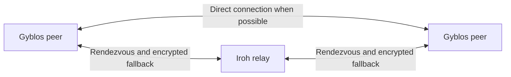

# Gyblos Infra

Deployment configuration and operational tooling for Gyblos's self-hosted
[Iroh](https://github.com/n0-computer/iroh) relay infrastructure.

Iroh peers try to communicate directly. A relay helps them establish contact
and carries encrypted traffic when a direct connection is unavailable. This
repository publishes reviewable, reusable configuration and operating procedures.
It does not implement Gyblos clients or payments.



## Current state

- `na1` is the declared active relay, on Hostinger with Dokploy.
- `na2` is planned; there is no second-relay redundancy today.
- Client integration remains a proposal.
- Open-source configuration does not grant access to the deployed service.
  Shared-token access requires coordination with its operator.

[Deployment status](docs/status.md) describes the topology, not live availability.

## Start here

| Your goal | Guide |
| --- | --- |
| Understand traffic and dependencies | [Architecture](docs/architecture.md) |
| Contribute or validate changes | [Contributing](CONTRIBUTING.md) |
| Deploy alongside Dokploy apps | [Dokploy](relay/DOKPLOY.md) — current na1 variant |
| Deploy on a dedicated VPS | [Standalone](relay/STANDALONE.md) |
| Find variables and configuration files | [Relay reference](relay/README.md) |
| Verify, monitor, back up or rotate tokens | [Operations](docs/operations.md) |
| Prepare deployment or rollback | [Release checklist](docs/release-checklist.md) |
| Work on consumer applications | [Client integration proposal](relay/node-config.md) |

## Validate locally

Requirements: Git, Docker Compose, Node.js 22 and a POSIX shell.

```sh
sh scripts/check.sh
```

This checks syntax, entrypoint regressions, both Compose variants with dummy
values and repository hygiene. It does not start containers or prove a deployed
relay works. Install Node dependencies only for the
[operational E2E](docs/operations.md#end-to-end-validation).

Workflows are manual while runner quota is unavailable. Local results are the
required validation evidence. See [monitor coverage](docs/operations.md#monitoring).

## Security and license

Keep credentials in the deployment environment and certificate backups encrypted
outside Git. Host state and customer data are outside this repository's scope.

Use the [private security policy](SECURITY.md) to report vulnerabilities.
The [threat model](relay/SECURITY.md) explains metadata exposure and access-control
assumptions. Licensed under [Apache-2.0](LICENSE).
